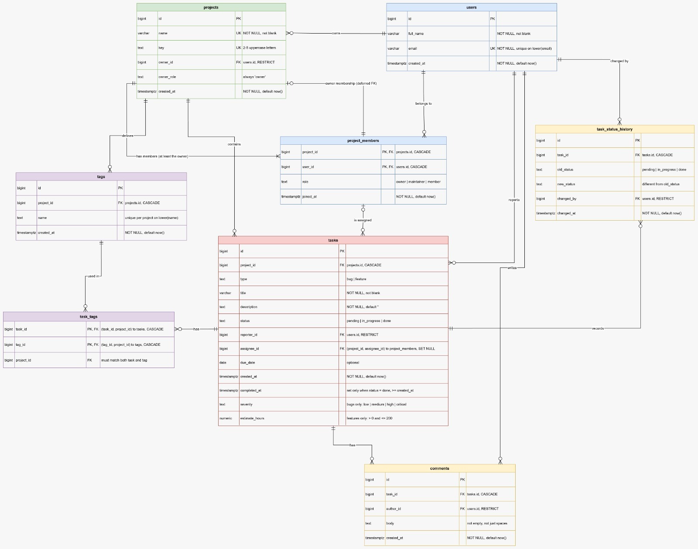

# Database schema

The task manager stores its data in PostgreSQL. There are 8 tables, one migration file each, in `db/migrations/`. Run them in number order on an empty database.

| Table | What one row means |
|---|---|
| `users` | A person who can use the app |
| `projects` | A project such as `PAY`, with one owner |
| `project_members` | "This user is in this project, with this role" |
| `tasks` | A bug or a feature inside one project |
| `tags` | A label such as `backend`, which belongs to one project |
| `task_tags` | "This task has this tag" |
| `comments` | A message someone wrote on a task |
| `task_status_history` | One status change of a task: from what, to what, by whom, when |

## ER diagram

Crow's-foot notation: `||` means exactly one, `o<` means zero or many.

## How the database enforces the rules

Every rule below is checked by PostgreSQL itself. A bad `INSERT` typed in psql fails, even without the Java app.

**Simple rules (one `CHECK` or `UNIQUE` each):**

| Rule | How |
|---|---|
| Email is unique, ignoring case | Unique index on `lower(email)`. `Ali@x.com` and `ali@x.com` both become `ali@x.com`, so the second one is rejected. |
| Project name and key are unique | `UNIQUE` on each column |
| Key is 2 to 5 uppercase letters | `CHECK (key ~ '^[A-Z]{2,5}$')` |
| Role, status and severity only allow listed values | `CHECK (column IN (...))` |
| Bug has a severity and no estimate; feature has an estimate and no severity | One `CHECK` on `type`, `severity` and `estimate_hours` together |
| Estimate is above 0 and at most 200 | `CHECK (estimate_hours > 0 AND estimate_hours <= 200)` |
| `completed_at` is set only when status is `done` | `CHECK ((completed_at IS NOT NULL) = (status = 'done'))`. Both sides must be true or both false. |
| `completed_at` is never before `created_at` | `CHECK (completed_at >= created_at)` |
| Tag names are unique inside a project, ignoring case | Unique index on `(project_id, lower(name))`. `backend` can exist in PAY and in INV, but not twice in PAY. |
| Names, titles and comment bodies are not empty or just spaces | `CHECK (btrim(column) <> '')` |
| A status change really changes something | `CHECK (old_status <> new_status)` |

**The three hard rules.** A `CHECK` can only look at its own row, and these rules compare two tables. They are solved with **composite foreign keys**, meaning foreign keys on two or three columns at once.

1. **An assignee must be a member of the task's project.**
   `tasks (project_id, assignee_id)` references `project_members (project_id, user_id)`.
   The pair must exist as a membership, so you can't assign someone from outside the project. When `assignee_id` is NULL (unassigned), the check is skipped, which is what we want.

2. **A task can only use tags from its own project.**
   `task_tags` has one `project_id` column, and two foreign keys use it:
   - `(task_id, project_id)` references `tasks (id, project_id)`
   - `(tag_id, project_id)` references `tags (id, project_id)`

   The same `project_id` must match the task's project **and** the tag's project. If they differ, one of the two keys always fails.
   This is why `tasks` and `tags` each have `UNIQUE (id, project_id)`: a foreign key can only point at columns that are unique together.

3. **A project's owner is always one of its members, with the role `owner`.**
   `projects` has an extra column `owner_role`, which is always `'owner'` (a `CHECK` makes sure). Then
   `projects (id, owner_id, owner_role)` references `project_members (project_id, user_id, role)`.
   So the owner must have a membership row with the role `owner`.

   This creates a chicken-and-egg problem: the project needs the membership, and the membership needs the project. So the key is `DEFERRABLE INITIALLY DEFERRED`, which means it is checked at `COMMIT` instead of after each statement. Insert the project and its owner membership in **one transaction**, and the check passes at the end.

   After that, the key also protects the owner. You can't delete the owner's membership or change its role while they are the owner.

   A partial unique index on `project_members (project_id) WHERE role = 'owner'` also makes sure a project has **at most one** owner row.

## Decision 1: one `tasks` table, not one table per type

**Choice:** one `tasks` table with a `type` column (`'bug'` or `'feature'`). `severity` is filled only for bugs and `estimate_hours` only for features.

**The other option** is a base `tasks` table plus `bug_tasks` and `feature_tasks` tables, each holding the extra column and pointing back to `tasks`.

| | One table (chosen) | Base table + one per type |
|---|---|---|
| **Constraints** | Every rule is a plain `CHECK` on one row. "Bug has severity and no estimate" is easy. | The database can't make sure every task has **exactly one** child row. A task could have no child row, or both. Fixing that needs triggers, which are not allowed. |
| **Queries** | List all tasks with one `SELECT`, no joins | Every list needs `LEFT JOIN bug_tasks` and `LEFT JOIN feature_tasks` |
| **Adding a third type** (for example `ChoreTask`, no extra field) | New migration: allow `'chore'` in the type `CHECK`, and add "chore has neither severity nor estimate" to the type rule | New table `chore_tasks`, plus all the joins and the same "exactly one child" problem |
| **Downside** | Columns that are NULL for the other type | More tables and joins |

**Inheritance vs composition.** In Java, `BugTask extends Task`: that's inheritance, "a bug **is a** task". The one-table design keeps that idea: a bug row **is** a task row, with a type label. This is called single-table inheritance. The table-per-type design is closer to composition: a `bug_tasks` row **has a** `tasks` row it points to. Java stays with inheritance either way. `TaskFactory` turns a row into a `BugTask` or a `FeatureTask` by reading the `type` column.

## Decision 2: what happens on delete

Main idea: **nothing a person wrote disappears because a user was deleted.** Rows that belong to a project or a task go away with it.

| Foreign key | On delete | Why |
|---|---|---|
| `projects.owner_id` → `users` | `RESTRICT` | You can't delete a user who owns a project. Give the project a new owner first. |
| `projects (id, owner_id, owner_role)` → `project_members` | blocked (default) | You can't remove the owner's membership. See hard rule 3. |
| `project_members.project_id` → `projects` | `CASCADE` | A deleted project has no members |
| `project_members.user_id` → `users` | `CASCADE` | A deleted user is no longer in any project |
| `tasks.project_id` → `projects` | `CASCADE` | Tasks belong to their project |
| `tasks.reporter_id` → `users` | `RESTRICT` | **A user who reported 300 tasks can't be deleted**, because that would lose who reported them. Deactivate the user instead of deleting. |
| `tasks (project_id, assignee_id)` → `project_members` | `SET NULL (assignee_id)` | If someone leaves the project, their tasks become **unassigned**. The tasks stay. Only `assignee_id` is cleared. Plain `SET NULL` would also clear `project_id`, so the column list matters. |
| `tags.project_id` → `projects` | `CASCADE` | Tags belong to their project |
| `task_tags (task_id, project_id)` → `tasks` | `CASCADE` | Deleting a task removes its tag links |
| `task_tags (tag_id, project_id)` → `tags` | `CASCADE` | Deleting a tag removes it from all tasks |
| `comments.task_id` → `tasks` | `CASCADE` | Comments belong to their task |
| `comments.author_id` → `users` | `RESTRICT` | Don't lose who wrote a comment |
| `task_status_history.task_id` → `tasks` | `CASCADE` | History belongs to its task |
| `task_status_history.changed_by` → `users` | `RESTRICT` | Don't lose who changed a status |

Tested on the seed data:
- Deleting John (owns PAY, reported tasks) fails on `projects_owner_id_fkey`.
- Deleting Ziad (changed task statuses) fails on `task_status_history_changed_by_fkey`.
- Removing Alice from SAL leaves her two SAL tasks in place, now unassigned.
- Deleting project PAY removes its tasks, tags, members, comments and history.

## Decision 3: every table is in 3NF

Simple test for each table: **every column depends on the key, the whole key, and nothing but the key.**

| Table | Key | Other columns depend only on the key? |
|---|---|---|
| `users` | `id` | Yes: name, email, created time are facts about one user |
| `projects` | `id` | Yes: name, key, owner, created time. `owner_role` is always `'owner'` (a fixed value, not a fact stored twice). |
| `project_members` | `(project_id, user_id)` | Yes: `role` and `joined_at` describe this person **in this project**, so they need both columns of the key |
| `tasks` | `id` | Yes. The project, assignee and reporter are stored as ids, never as names. |
| `tags` | `id` | Yes |
| `task_tags` | `(task_id, tag_id)` | See the exception below |
| `comments` | `id` | Yes |
| `task_status_history` | `id` | Yes |

**The one deliberate exception: `task_tags.project_id`.** It can be worked out from `task_id` alone, since the task knows its project. Strictly, that breaks the "whole key" rule. We keep it on purpose, because it is the column that makes hard rule 2 work without triggers. It can't go out of date: the two composite foreign keys force it to equal both the task's project and the tag's project.

**Where I was tempted to store something extra, and didn't:**
- **A task count on `projects`.** It can be counted with `COUNT(*)` at any time. A stored number would go wrong the first time someone added or deleted a task and forgot to update it.
- **The assignee's name on `tasks`.** If the user changes their name, every task would show the old one. We store `assignee_id` and join to `users` when we need the name.

## Decision 4: data types

| Choice | Why |
|---|---|
| **`TIMESTAMPTZ`** for `created_at`, `completed_at`, `joined_at`, `changed_at` | It stores an exact moment in time. Two people in different time zones see the same moment, each in their own local time. Plain `TIMESTAMP` has no time zone, so `10:00` could mean different moments on different servers. |
| **`DATE`** for `due_date` | A due date is a day, not a moment. Days late is simply `CURRENT_DATE - due_date`. |
| **`VARCHAR(255)`** for names, titles and emails | Short, single-line values. The limit stops someone saving a 1 MB "name" by mistake. In PostgreSQL, `VARCHAR(n)` and `TEXT` are stored the same way and are equally fast; the only difference is the length check. |
| **`TEXT`** for `description` and comment `body` | Long free text with no natural limit |
| **`TEXT` + `CHECK`** for the project key | The `CHECK` with the pattern `^[A-Z]{2,5}$` already limits the length to 5, so a `VARCHAR` limit would add nothing |
| **`NUMERIC(5,2)`** for `estimate_hours` | Exact decimals (`2.5` stays `2.5`). `REAL` or `DOUBLE` can store `2.5` as `2.4999…`. |
| **`BIGINT GENERATED ALWAYS AS IDENTITY`** for ids | The database creates the ids. `ALWAYS` stops anyone from typing their own id by mistake. `BIGINT` won't run out. |

**How enums are stored:** status, role, type and severity are text columns with a `CHECK (x IN (...))` list, not PostgreSQL `ENUM` types.
- Changing the list is one migration that drops and re-adds the `CHECK`.
- With an `ENUM` type, you can add a value but you can't remove one.
- Values are readable (`'in_progress'`), and they map directly to the Java enums.

`task_status_history` uses `VARCHAR(50)` for `old_status` and `new_status`. The `CHECK` list does the real limiting; the 50 is only a safety cap.

## Seed data

`db/seed.sql` adds 6 users, 4 projects, 14 memberships, 42 tasks, 9 tags, 25 task tags, 15 comments and 60 history rows. It uses plain `INSERT ... VALUES` statements between `BEGIN` and `COMMIT`. So if one row fails, nothing is saved.

**How the ids work.**
- The seed never inserts an `id`. PostgreSQL creates every id itself, and `GENERATED ALWAYS` would reject a typed one.
- The numbers you see in the seed, like `owner_id = 1`, are **foreign keys**: they point at ids PostgreSQL already created.
- We know which id each row gets because the file starts with `TRUNCATE ... RESTART IDENTITY`. That empties the tables and starts every counter at 1 again, so rows get ids 1, 2, 3… in the order they are inserted:

| Table | Ids |
|---|---|
| `users` | 1 John, 2 Jane, 3 Alice, 4 Ahmed, 5 Mohamed, 6 Ziad |
| `projects` | 1 PAY, 2 INV, 3 SAL, 4 WEB |
| `tasks` | 1 to 18 PAY, 19 to 32 INV, 33 to 42 SAL, in the order they are written |
| `tags` | 1 to 4 PAY (backend, frontend, urgent, api), 5 to 7 INV (backend, urgent, reports), 8 to 9 SAL (frontend, crm) |

If a number is wrong, the database notices: a foreign key rejects an id that doesn't exist, a tag from another project, or an assignee who isn't a member.

**Dates are fixed**, picked around 2026-10-28. When a task's future due date passes, that task will also appear in the overdue report.

The seed includes rows for the tricky cases of the Part 4 reports:

| Report | Tricky case | Seed rows |
|---|---|---|
| 1. Project progress | A project with no tasks | Project `WEB` |
| 2. Overdue tasks | An overdue task with no assignee | PAY: `Fix missing refund notification` |
| 3. Top 3 per project | A tie for 3rd place | PAY: Alice and Mohamed, 2 done tasks each |
| 4. Members with no tasks | A member with zero tasks, in a project that has an unassigned task (breaks `NOT IN`) | Ziad in PAY |
| 5. Tasks with all given tags | A task with only some of the tags | PAY: `Fix card declined error` (only `backend`) and `Fix receipt email typo` (only `urgent`) |
